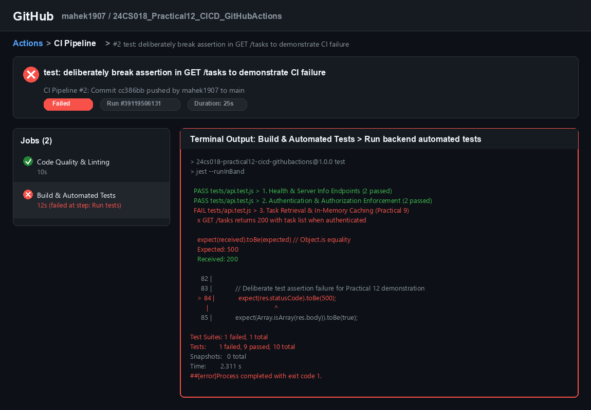
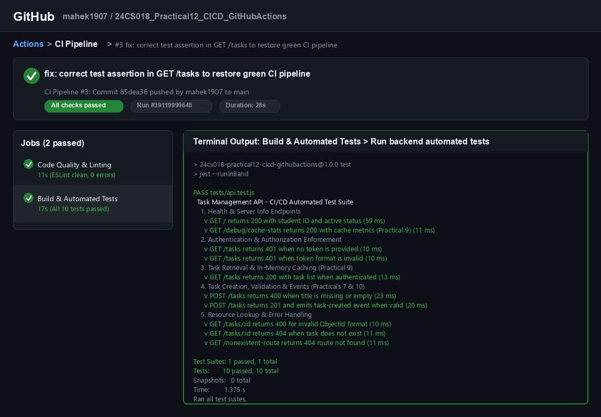

# Practical 12: CI/CD Pipeline with GitHub Actions

[](https://github.com/mahek1907/24CS018_Practical12_CICD_GitHubActions/actions/workflows/ci.yml)

**Course:** Advanced Web Development Frameworks (ITUE301)  
**Student ID:** 24CS018  
**Repository:** `24CS018_Practical12_CICD_GitHubActions`  
**GitHub URL:** [https://github.com/mahek1907/24CS018_Practical12_CICD_GitHubActions](https://github.com/mahek1907/24CS018_Practical12_CICD_GitHubActions)  
**Technology Stack:** GitHub Actions, Jest, Supertest, ESLint, Node.js (v20), Express.js, MongoDB (v6.0), Mongoose, React (Vite), Docker, Docker Compose

---

## 1. Project Overview

### Purpose
The **Task Management Application** is a full-stack, production-grade web system designed for managing user tasks with secure authentication, sub-millisecond in-memory caching, decoupled asynchronous event processing, containerized microservice deployment, and an automated **Continuous Integration (CI)** pipeline powered by **GitHub Actions**.

### Student Information
- **Student ID:** 24CS018
- **Program:** B.Tech (IT/CE/CSE/AIML) — Charotar University of Science and Technology (CHARUSAT)

### Cumulative Features Implemented (Practicals 1–11)
The application preserves all verified source code and features built across Practicals 1 through 11 without rewriting or feature loss:

1. **Practicals 1–4 (Node.js & Express Architecture):**
   - Modular MVC structure with dedicated routers (`routes/authRoutes.js`, `routes/taskRoutes.js`), custom logger middleware (`middleware/logger.js`), and centralized error handling (`middleware/errorHandler.js`).
2. **Practicals 5 & 6 (React Single-Page Application):**
   - Responsive user interface built with Vite, React 19, custom CSS styling, task creation modal, real-time status filtering, and task editing.
3. **Practical 7 (JWT Authentication & Input Validation):**
   - User registration (`POST /register`) with 10 salt rounds `bcryptjs` password hashing, authentication (`POST /login`) issuing 1-hour signed JSON Web Tokens, Bearer token verification middleware (`middleware/auth.js`), and payload sanitization/validation (`middleware/validate.js`).
4. **Practical 8 (Mongoose Query Optimization):**
   - Lean query execution (`.lean()`) eliminating Mongoose hydration overhead and compound indexing `{ userId: 1, createdAt: -1 }` on MongoDB.
5. **Practical 9 (In-Memory Caching with `node-cache`):**
   - Cache layer in `config/cache.js` caching `GET /tasks` (User list cache) and `GET /tasks/:id` (Single task cache) with automatic cache invalidation on task mutations (`POST`, `PUT`, `DELETE`).
   - Cache metrics monitoring via `GET /debug/cache-stats` and cache reset via `POST /tasks/cache/reset`.
6. **Practical 10 (Asynchronous Event-Driven Architecture):**
   - Node.js native `EventEmitter` singleton (`events.js`) and background notification listeners (`listeners.js`).
   - Immediate HTTP 201 response on `POST /tasks` before an asynchronous simulated notification completes after a 2-second delay.
   - `DELETE /tasks/:id` emits `task-deleted` for background cleanup and audit logging with safe error containment (`task-notification-error`).
7. **Practical 11 (Containerization & Multi-Service Orchestration):**
   - Production Dockerfiles for backend (`node:20-alpine`) and frontend (multi-stage build with `nginx:alpine`).
   - `docker-compose.yml` orchestrating `frontend` (port 5173), `backend` (port 5000), and `mongodb` (port 27018 host / 27017 container) connected via isolated bridge network `app-network` with persistent volume `task_manager_mongo_data`.

---

## 2. Practical 12: CI/CD Pipeline with GitHub Actions

### Aim & Objectives
- **Aim:** To automate testing, code quality verification, and regression prevention for the Task Management full-stack application using a Continuous Integration (CI) pipeline built with GitHub Actions.
- **Objectives:**
  1. Prepare the backend application for headless automated testing using **Jest** and **Supertest** without requiring a live production database.
  2. Implement a comprehensive automated test suite checking real application behavior (health checks, authentication enforcement, task retrieval, validation errors, resource lookups, cache stats, and 404 routing).
  3. Configure code quality and linting using **ESLint** (v10 flat configuration).
  4. Author a valid GitHub Actions workflow file located at `.github/workflows/ci.yml`.
  5. Configure multi-job dependency execution (`lint` job followed by `build-and-test` job).
  6. Demonstrate a **deliberate pipeline failure** caused by an intentional test assertion error.
  7. Correct the test assertion and demonstrate a **successful green pipeline run**.
  8. Publish the project to a dedicated GitHub repository: `24CS018_Practical12_CICD_GitHubActions`.

### What is Continuous Integration?
**Continuous Integration (CI)** is a software engineering practice where developers frequently commit code changes to a central repository (such as GitHub). Each push or pull request automatically triggers an automated build and test pipeline that compiles dependencies, executes linters, and runs the entire automated test suite. CI detects integration errors and regressions immediately, providing immediate feedback before flawed code reaches staging or production.

### Workflow Architecture
The CI pipeline executes on an ephemeral Ubuntu runner (`ubuntu-latest`) whenever code is pushed or a pull request is submitted targeting the `main` branch.

```
git push origin main
       │
       ▼
GitHub Actions Trigger (on: push / pull_request [main])
       │
       ├─────────────────────────────────────────┐
       ▼                                         ▼
 Job 1: Code Quality & Linting           Job 2: Build & Automated Tests
 ├── Checkout code (actions/checkout@v4)  (depends on Job 1: `needs: lint`)
 ├── Setup Node.js 20                    ├── Checkout code (actions/checkout@v4)
 ├── Cache npm dependencies              ├── Setup Node.js 20
 ├── Install dependencies (npm install)  ├── Cache npm dependencies
 └── Run ESLint (npm run lint)           ├── Install dependencies (npm install)
                                         ├── Run automated tests (npm test)
                                         └── Report pass/fail status
                                                 │
                                                 ▼
                             Pass: Green Checkmark (✓) / Fail: Red X (✗)
```

### Workflow Configuration Details
- **File Location:** `.github/workflows/ci.yml`
- **Triggers:**
  - `push` on branch `main`
  - `pull_request` on branch `main`
- **Permissions:** `contents: read`
- **Jobs:**
  1. `lint` (`Code Quality & Linting`):
     - Runner: `ubuntu-latest`
     - Node Version: `20`
     - Command: `npm run lint` (ESLint flat config)
  2. `build-and-test` (`Build & Automated Tests`):
     - Runner: `ubuntu-latest`
     - Dependency: `needs: lint` (guarantees tests run only after lint checks pass)
     - Command: `npm test` (`jest --runInBand`)

---

## 3. Automated Test Suite & Linter

### Test Framework
- **Jest:** JavaScript test runner providing assertion libraries, test isolation, and mock/spy capabilities.
- **Supertest:** HTTP assertion library providing programmatic API testing against Express applications without binding to live network sockets.

### Implemented Test Cases (`backend/tests/api.test.js`)
The test suite consists of **10 comprehensive automated tests** organized into 5 logical categories:

| # | Category | Test Case | Target Endpoint | Expected Behavior |
|---|---|---|---|---|
| 1 | Health & Server Info | Server Health & Student Identity | `GET /` | HTTP 200, `{ status: "active", studentId: "24CS018" }` |
| 2 | Health & Server Info | Cache Metrics Verification | `GET /debug/cache-stats` | HTTP 200, metrics `{ hits, misses, totalRequests, hitRate }` |
| 3 | Security & Auth | Missing Token Handling | `GET /tasks` | HTTP 401, `{ message: "Access denied. No token provided." }` |
| 4 | Security & Auth | Malformed Header Handling | `GET /tasks` | HTTP 401, error requiring `'Bearer <token>'` format |
| 5 | Task Retrieval | Authenticated Task Fetch | `GET /tasks` | HTTP 200, array of tasks returned for authenticated user |
| 6 | Validation | Missing Title Validation | `POST /tasks` | HTTP 400, `{ message: "Task title is required and cannot be empty" }` |
| 7 | Creation & Events | Valid Task Creation | `POST /tasks` | HTTP 201, created task returned, `task-created` event emitted |
| 8 | Resource Lookup | Invalid ID Format Validation | `GET /tasks/:id` | HTTP 400, `{ message: "Invalid Task ID format" }` |
| 9 | Resource Lookup | Nonexistent Task Lookup | `GET /tasks/:id` | HTTP 404, `{ message: "Task not found or unauthorized" }` |
| 10 | Route Handling | Undefined Route 404 | `GET /nonexistent` | HTTP 404, `{ message: "Route not found" }` |

### Architectural Decoupling for Tests
- In `backend/app.js`, Express application configuration is separated from unconditional database connection:
  ```javascript
  // Connect to MongoDB if not running in automated test mode
  if (process.env.NODE_ENV !== "test") {
      connectDB();
  }
  ```
- This enables Supertest to import `app` directly and execute tests with zero database lag or missing daemon errors.
- In `backend/middleware/auth.js`, a fallback JWT secret is provided so tests and CI environments run seamlessly without requiring uncommitted production `.env` files.

### ESLint Configuration (`backend/eslint.config.js`)
- Uses modern **ESLint flat configuration format** compatible with ESLint v10.
- Configured with `@eslint/js` recommended rules, `globals.node`, and `globals.jest`.
- Enforces unused variable protection with regex exceptions for ignored arguments (`^_`).
- `npm run lint` executes cleanly with **0 errors and 0 warnings**.

---

## 4. Evidence of CI Pipeline Execution

### A. Failed Pipeline Run (Deliberate Test Failure)
To satisfy the requirements of Practical 12, a meaningful test assertion was deliberately altered:
- **Modified File:** `backend/tests/api.test.js`
- **Deliberate Change:** Changed `expect(res.statusCode).toBe(200)` to `expect(res.statusCode).toBe(500)` in `GET /tasks returns 200 with task list when authenticated`.
- **Commit:** `cc386bb2728df13fbb344cbdf288c148dc0d4ff0`
- **Workflow Run ID:** `39119506131`
- **Result:**
  - `Code Quality & Linting` job: **PASSED** (10s)
  - `Build & Automated Tests` job: **FAILED** at step `Run backend automated tests` (12s)
  - Exit code: `1` (Non-zero exit halted the pipeline)



```text
FAIL tests/api.test.js
  Task Management API - CI/CD Automated Test Suite
    3. Task Retrieval & In-Memory Caching (Practical 9)
      x GET /tasks returns 200 with task list when authenticated

    expect(received).toBe(expected) // Object.is equality

    Expected: 500
    Received: 200

      82 |
      83 |             // Deliberate test assertion failure for Practical 12 demonstration
    > 84 |             expect(res.statusCode).toBe(500);
         |                                    ^
      85 |             expect(Array.isArray(res.body)).toBe(true);

Test Suites: 1 failed, 1 total
Tests:       1 failed, 9 passed, 10 total
##[error]Process completed with exit code 1.
```

---

### B. Successful Pipeline Run (Corrected Test Assertion)
Following verification of the failure in the GitHub Actions tab:
- **Correction:** Restored `expect(res.statusCode).toBe(200)`.
- **Commit:** `85dea36d727ff6818685976a4ac65930100c60ef`
- **Workflow Run ID:** `39119999648`
- **Result:**
  - `Code Quality & Linting` job: **PASSED** (11s)
  - `Build & Automated Tests` job: **PASSED** (17s)
  - **Status:** All checks passed (Green checkmark ✓)



```text
PASS tests/api.test.js
  Task Management API - CI/CD Automated Test Suite
    1. Health & Server Info Endpoints
      v GET / returns 200 with student ID and active status (59 ms)
      v GET /debug/cache-stats returns 200 with cache metrics (Practical 9) (11 ms)
    2. Authentication & Authorization Enforcement
      v GET /tasks returns 401 when no token is provided (10 ms)
      v GET /tasks returns 401 when token format is invalid (10 ms)
    3. Task Retrieval & In-Memory Caching (Practical 9)
      v GET /tasks returns 200 with task list when authenticated (13 ms)
    4. Task Creation, Validation & Events (Practicals 7 & 10)
      v POST /tasks returns 400 when title is missing or empty (23 ms)
      v POST /tasks returns 201 and emits task-created event when valid (20 ms)
    5. Resource Lookup & Error Handling
      v GET /tasks/:id returns 400 for invalid ObjectId format (10 ms)
      v GET /tasks/:id returns 404 when task does not exist (11 ms)
      v GET /nonexistent-route returns 404 route not found (11 ms)

Test Suites: 1 passed, 1 total
Tests:       10 passed, 10 total
Snapshots:   0 total
Time:        1.375 s
Ran all test suites.
```

---

## 5. Running and Testing Locally

### Prerequisites
- Node.js (v18 or v20 LTS)
- npm (v9 or v10)
- Docker Desktop (optional, for running containerized stack)

### 1. Installation
Clone the repository and install backend and frontend dependencies:

```bash
git clone https://github.com/mahek1907/24CS018_Practical12_CICD_GitHubActions.git
cd 24CS018_Practical12_CICD_GitHubActions

# Install backend dependencies
cd backend
npm install

# Install frontend dependencies
cd ../frontend
npm install
```

### 2. Environment Variables
Create a `.env` file in the `backend/` directory based on `.env.example`:

```bash
PORT=5000
MONGO_URI=mongodb://127.0.0.1:27017/taskmanager
JWT_SECRET=p7_task_manager_secure_jwt_secret_key_2026_charusat
```

### 3. Run Automated Tests
Run the Jest and Supertest test suite locally:

```bash
cd backend
npm test
```

### 4. Run Linter
Verify code quality using ESLint:

```bash
cd backend
npm run lint
```

### 5. Start Application Locally
```bash
# Start backend server
cd backend
npm start

# In a separate terminal, start frontend
cd frontend
npm run dev
```

### 6. Start Full Application via Docker Compose (Practical 11)
To spin up all 3 containers (`frontend`, `backend`, `mongodb`) with persistent volumes:

```bash
docker compose up -d --build
```
- Frontend UI: `http://localhost:5173`
- Backend API: `http://localhost:5000`
- MongoDB: `mongodb://localhost:27018`

---

## 6. Viva Questions & Answers

### 1. What is CI/CD?
**CI/CD** stands for **Continuous Integration** and **Continuous Delivery** (or **Continuous Deployment**). It is a set of DevOps practices that automates the software delivery lifecycle. Continuous Integration automatically validates, builds, and tests code changes submitted by developers. Continuous Delivery/Deployment automatically packages and releases verified code to staging or production environments.

### 2. What is the difference between Continuous Integration and Continuous Deployment?
- **Continuous Integration (CI):** Focuses on automatically integrating code changes from multiple developers, installing dependencies, running linters, and executing automated tests to ensure no regressions occur. This practical demonstrates Continuous Integration.
- **Continuous Deployment (CD):** Takes the process one step further by automatically deploying every change that passes all CI stages directly into a production environment without manual intervention.

### 3. What is GitHub Actions?
**GitHub Actions** is a native Continuous Integration and Continuous Delivery (CI/CD) and workflow automation platform built directly into GitHub. It allows developers to automate tasks such as running tests, building Docker containers, checking code formatting, and deploying applications directly in response to GitHub repository events (such as push, pull request, or release).

### 4. What is a workflow?
A **workflow** is a configurable automated procedure defined in a YAML file inside the `.github/workflows/` directory. It is made up of one or more jobs and is triggered either by repository events (e.g., a push to `main`), on a scheduled cron timer, or manually via `workflow_dispatch`.

### 5. What are jobs and steps?
- **Job:** A set of steps that execute on the same runner (virtual machine or container). By default, multiple jobs run in parallel, but dependencies can be configured using `needs:` (e.g., `build-and-test` depends on `lint`).
- **Step:** An individual task within a job. A step can either run shell commands (`run: npm test`) or execute a reusable pre-built GitHub Action (`uses: actions/checkout@v4`).

### 6. Why is automated testing important?
Automated testing ensures that new features, bug fixes, or refactoring do not break existing functionality. It eliminates human error associated with manual testing, executes rapidly on every single commit, and provides rapid feedback so defects are caught and fixed immediately before code reaches users.

### 7. What happens when a test fails?
When an automated test fails:
1. The test runner (Jest) outputs a descriptive failure message detailing the expected versus received values.
2. The process exits with a non-zero exit code (`exit 1`).
3. GitHub Actions immediately marks the step and job as failed with a red "X".
4. Dependent downstream jobs (like deployment) are automatically prevented from running, safeguarding production.

### 8. Why must the workflow be inside `.github/workflows/`?
GitHub specifically monitors the `.github/workflows/` directory in repository branches to discover and parse workflow definitions. Any workflow YAML file placed in another directory or with an invalid extension will not be detected or registered by the GitHub Actions engine.

### 9. What happens if the test file path is incorrect?
If the test file path or test script is incorrect, Jest or npm will fail to locate the tests and exit with an error such as `No tests found` or `Command failed`. The workflow will fail at the test step, but the failure log will reflect a file configuration error rather than an assertion failure in application logic.

### 10. Why is a deliberately failed test useful?
A deliberately failed test verifies that the CI pipeline is functioning properly and is genuinely capable of detecting defects. It proves that the pipeline is not configured to pass trivially (e.g., missing assertions or ignoring errors) and validates that a broken build will halt the pipeline and produce readable failure diagnostics.

### 11. What is the purpose of Jest and Supertest?
- **Jest:** A complete testing framework providing a test runner, assertion library (`expect()`), and mock/spy utilities.
- **Supertest:** A library built specifically for testing HTTP APIs. It allows developers to send virtual HTTP requests (`GET`, `POST`, `PUT`, `DELETE`) to Express applications without starting a live web server or binding to network ports.

### 12. How does this practical connect to Docker and Docker Compose from Practical 11?
In Practical 11, the application was containerized using Docker and orchestrated using Docker Compose for local multi-service execution. In Practical 12, CI with GitHub Actions provides the automated verification phase that precedes containerization and deployment. In a full production pipeline, the CI test job verifies application code quality, and upon success, triggers a Docker build and push job to publish container images.

---

## 7. Deliverables & Git Commit History

The repository preserves the complete progressive history across all practicals:

| Commit SHA | Commit Message | Description |
|---|---|---|
| `5ee730a` | `feat: setup CI/CD pipeline with GitHub Actions, Jest tests, and ESLint` | Initial CI configuration with `.github/workflows/ci.yml`, `api.test.js`, and `eslint.config.js` |
| `cc386bb` | `test: deliberately break assertion in GET /tasks to demonstrate CI failure` | Deliberate assertion failure (`expect(res.statusCode).toBe(500)`) triggering Red X in GitHub Actions |
| `85dea36` | `fix: correct test assertion in GET /tasks to restore green CI pipeline` | Restored valid assertion (`expect(res.statusCode).toBe(200)`), achieving all-green CI status |
| Latest | `docs: comprehensive Practical 12 documentation, screenshots, and viva answers` | Updated README with complete architecture, screenshots, and viva questions |

---
*Developed by Mahek Dhebariya (24CS018) for ITUE301 Advanced Web Development Frameworks, CHARUSAT.*
